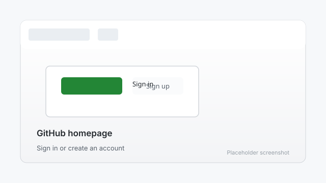
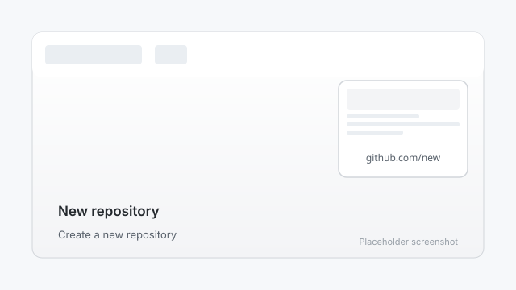

# 1. Create a GitHub repository

A repository (or "repo") is a folder that GitHub stores for you. Your website's files will live here.

## Step 1: Sign in to GitHub

1. Go to [github.com](https://github.com).
2. If you already have an account, click **Sign in**. If not, click **Sign up** and create a free account.
3. Once you are signed in, you will see your GitHub homepage.

## Step 2: Create a new repository

1. In the top-right corner of any GitHub page, click the **+** icon, then click **New repository**.
2. Give your repository a name. For an author site, a good choice is `yourusername.github.io` (replace `yourusername` with your GitHub username). This name makes your site easy to find later.
3. Add a short description, for example: "My free author website."
4. Choose **Public**. GitHub Pages is free for public repositories.
5. Leave **Initialize this repository with a README** unchecked for now — we will add files in the next steps.
6. Click **Create repository**.

## Step 3: What happens next

GitHub creates your repository and shows a quick setup page. Keep this tab open — you will add your website files in the next steps.

## Key terms

- **Repository (repo):** A project folder stored on GitHub.
- **Public:** Anyone can see it. Required for free GitHub Pages sites.
- **README:** A welcome file that explains what a repository is for.

---

Next: [Add GitHub Pages](02-add-pages.md)
