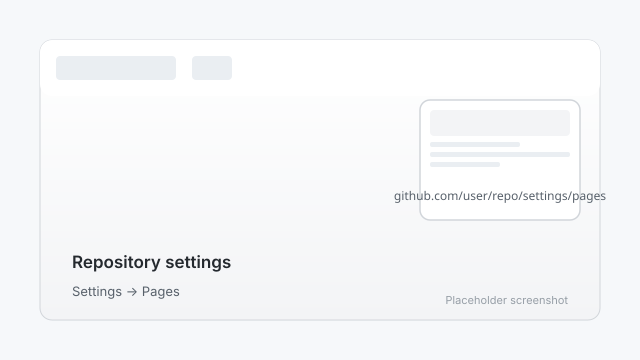
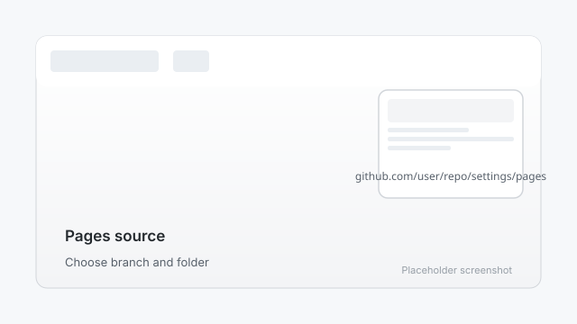

# 2. Add GitHub Pages

GitHub Pages is GitHub's free hosting service. It turns your repository into a live website.

## Step 1: Open repository settings

1. On your repository's main page, click the **Settings** tab near the top.
2. In the left-hand sidebar, click **Pages**.



## Step 2: Choose your source

Under "Build and deployment" > "Source":

1. Click the dropdown under **Branch**.
2. Choose **main** (or **master**, if that is your repository's default branch).
3. Choose the folder `/ (root)`.
4. Click **Save**.



## Step 3: Wait for the site to build

GitHub will start building your site. This usually takes a minute or two. Refresh the page until you see a green checkmark and a link like:

```
https://yourusername.github.io/
```

That link is your live website. Even if there are no files yet, visiting it shows GitHub's default Pages page.

## Troubleshooting

- **I don't see Pages in the sidebar:** Make sure your repository is public. Private repositories require a paid GitHub plan for Pages.
- **The link shows a 404:** Your site may still be building. Wait a minute and refresh.

---

Next: [Choose a theme](03-choose-theme.md)
