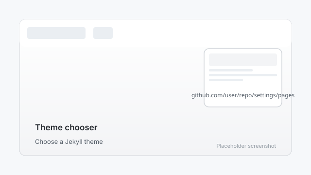

# 3. Choose a theme

A theme controls how your site looks — colors, fonts, and layout. You can change it later at any time.

## Option A: Jekyll themes (built into GitHub Pages)

1. In your repository settings, click **Pages** in the left sidebar.
2. Under "Theme", click **Choose a theme**.
3. Browse the themes. **Minima**, **Cayman**, and **Slate** are good beginner choices.
4. Click a theme to preview it, then click **Select theme**.
5. GitHub adds a theme file to your repository and rebuilds your site.

## Option B: Use your own HTML files (the `site/` template)

This manual includes a ready-to-use static HTML author site in the `site/` folder. If you use it, you do not need a Jekyll theme — just upload the HTML files (see step 4).

## Which should you pick?

- Pick a Jekyll theme if you want to write blog posts in Markdown and let GitHub handle the design.
- Use the `site/` HTML template if you want full control over the design without learning new tools.

---

Next: [Edit your content](04-edit-content.md)
