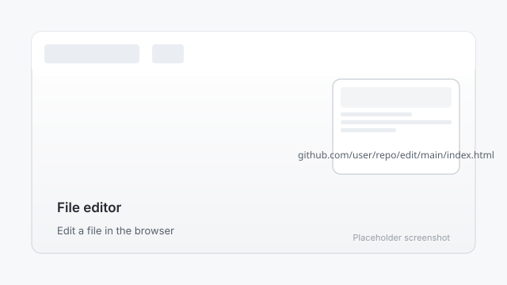

# 4. Edit your content

Now add your own words: your author bio, your books, and how readers can reach you.

## Editing on GitHub (easiest for beginners)

1. On your repository's main page, click **Add file** → **Create new file**.
2. Name the file `index.html` (your site's home page).
3. Paste in your HTML. You can copy from the `site/` folder in this manual.
4. Click **Commit changes...**, then click **Commit changes** again.

## Editing on your computer

1. Clone the repository, or download it as a ZIP from the green **Code** button.
2. Open the HTML files in any text editor (Notepad, TextEdit, or VS Code).
3. Change the text, save the files, and upload them back to GitHub. Drag and drop works on the repository page.

## What to change first

- Your name and an author photo
- Your book covers and descriptions
- Your contact email or contact link

## Publishing your edits

After you commit changes, GitHub rebuilds your site automatically. Your updates appear within a minute or two at `https://yourusername.github.io/`.

---

Next: [Publish your site](05-publish.md)
